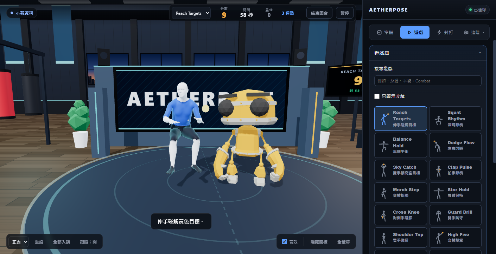

# Aetherpose

用 6 顆 IMU 追蹤器（Arduino Nano 33 BLE）做全身動作捕捉：追蹤器用 BLE 傳方向與加速度，Rust 後端整理成骨架，TransPose 推論出 SMPL 人體，瀏覽器顯示 3D 人體並提供小遊戲與 Combat 對打。



```
IMU 追蹤器 ──BLE──> 後端 aetherpose.exe ──ws :9009──> 網頁控制面板（追蹤器、校正、設定）
                         │
                         └──ws :9009──> frontend/mesh_bridge.py ──ws :9010──> 3D 人體、小遊戲、Combat
                                         (TransPose 推論)
網頁伺服器：http://127.0.0.1:18080/
```

## 開始使用

本次工作範圍為軟體成熟化，硬體穿戴不列為完成條件。不用 IMU 的環境檢查、模擬展示、驗收與交付步驟見 [軟體展示與驗收](docs/software-delivery.md)。軟體模擬結果保留其來源，不能宣稱真人動作精度。

專案圖文總覽見 [專案整理頁](docs/project-overview.html)。`config.json` 是執行時的本機設定，不納入 Git；首次啟動會建立預設值，也可先複製 `config.example.json` 為 `config.json` 再調整。

```powershell
cd aetherpose
.\setup.ps1      # 安裝 Python 套件、檢查外部檔案、編譯後端
.\run.ps1        # 啟動後端、推論與網頁，開啟瀏覽器（已在執行的服務會沿用）
.\run.ps1 -Restart  # 更新程式後：關掉舊服務，後端程式碼較新時重新編譯，再啟動
.\stop.ps1       # 關閉
```

TransPose、SMPL 模型、權重與 DIP-IMU 不在專案裡，路徑寫在 `external_paths.json`（複製 `external_paths.example.json`），用 `python frontend\external_paths.py` 檢查。完整步驟見 [HANDOFF.md](HANDOFF.md)。

## 連接埠

18080、9009、9010 只在本機（127.0.0.1）監聽，WebSocket 也只接受本機頁面。9003 與 9002 在所有網路介面上接收 UDP，區域網路上的 Wi-Fi 追蹤器與 Quest 才連得到；同一個網路上的其他裝置也能送資料進來，在不信任的網路上請用 Windows 防火牆擋掉這兩個埠。

| 埠 | 用途 |
|---|---|
| 18080 | 網頁與本機工具 API（`webui/server.py`） |
| 9009 | 後端 WebSocket：追蹤器狀態、設定、指令 |
| 9010 | 推論服務 WebSocket：關節位置與旋轉（頁面據此算出 SMPL 人體網格） |
| 9000（送出） | OSC 骨架輸出，依 VRChat 規格送追蹤器 1–8（髖、胸、雙腳、雙膝、雙肘）與 head；預設 127.0.0.1:9000（VRChat 的 OSC 接收埠），可在「進階 › 系統」分頁修改 |
| 9003（UDP 接收） | Wi-Fi 追蹤器的 UDP 封包；設定在 `config.json` 的 `udp_input_port`，與 OSC 輸出分開 |
| 9002（UDP 接收） | Quest 頭顯與手把的姿態橋接；超過 0.5 秒沒有新資料就不使用，「進階 › 骨架」分頁顯示是否連線 |

## 專案結構

| 位置 | 內容 |
|---|---|
| `src/` | Rust 後端：BLE 接收、姿態融合、IK、OSC 輸出、錄製、WebSocket（埠 9009）。設定存在 `config.json` |
| `src/skeleton/tracker_firmware/` | 追蹤器韌體（x-io Fusion AHRS） |
| `frontend/` | `mesh_bridge.py` 推論服務（埠 9010）、`transpose_runner.py`、`smpl_fk.py`、`external_paths.py`、`body_calibration.py` |
| `webui/` | 瀏覽器介面：主控面板、共用 3D 場景與訓練場（`environment.js`）、小遊戲、Combat、場景物件與道具庫、磁力計校正；`server.py` 頁面伺服器（含本機工具 API）、`run.ps1`／`stop.ps1` |
| `tools/` | `calibrate_tracker.py` 磁力計校正與燒錄、`make_scene_props.py` 產生場景庫的訓練道具、`simulate_trackers.py` 沒有硬體時用 UDP 模擬追蹤器、`imu_axes.py` 不經後端直接用 BLE 檢視單顆 IMU（主介面「進階 › 監控」分頁的「三軸 ↗」開的是同一個頁面） |
| `recordings/` | 「進階 › 系統」分頁錄製的骨架 CSV（不進 git） |
| `logs/` | 後端、推論服務、網頁伺服器的 log 與 BLE 連線紀錄（`run.ps1` 建立，不進 git） |
| `tests/` | 軟體測試；`tests\run_software_checks.ps1` 全部執行，加 `-Live` 會啟動服務測實際流程 |

## 文件

畢設成熟化的核心範圍、分階段工作與實測通過條件見 [畢設執行計畫](docs/graduation-plan.md)。尚未完成的實體測試不得以模擬結果代替。

目前是否達到交付程度與剩餘證據，見 [畢設程度評估](docs/graduation-readiness.md)。真人正／負例的標註及分析流程見 [深蹲試次分析](docs/action-evaluation.md)。

實測前請依 [實驗記錄說明](docs/experiments.md) 保存版本、輸入來源與逐顆追蹤器紀錄。

推論更新偏慢或動作輸入被略過時，依 [效能診斷](docs/performance.md) 保存分段負載與積壓計數。

正式報告的文字工作來源為 [成果報告審閱草稿](docs/thesis-source.md)。它依現行架構與證據重整；實體實驗、作者資料及 Word 排版仍待完成，上層舊計畫書與前三章檔案保留為歷史版本。

提供老師或接手者的原始碼快照，依 [提交包說明](docs/submission.md) 建立與驗證；個人設定、模型及實驗紀錄不會自動納入。

| 文件 | 內容 |
|---|---|
| [HANDOFF.md](HANDOFF.md) | 從零開始：韌體、環境、外部檔案、啟動、磁力計校正、常見問題 |
| [webui/README.md](webui/README.md) | 網頁介面、小遊戲規則、Combat、場景物件、回歸測試 |
| [EXTERNAL_DEPENDENCIES.md](EXTERNAL_DEPENDENCIES.md) | 外部方法、資料與授權 |
| [tools/IMU_AXES_README.md](tools/IMU_AXES_README.md) | 韌體座標軸與單顆 IMU 測試 |
| [docs/acceptance-status.md](docs/acceptance-status.md) | 軟體驗收紀錄 |
