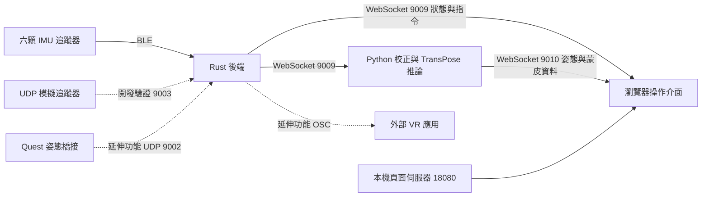

# Aetherpose 畢業專題成果報告審閱草稿

本文是後續報告的唯一工作文字來源，版本日期為 2026 年 10 月 14 日。它整理現行系統與已取得的軟體證據，供組員與指導教師審閱；實體穿戴實驗、正式封面資料與排版尚未完成，不可直接當作最終繳交本。上層既有計畫書及前三章文件保留為歷史版本。

正式題目暫定為「基於六顆慣性感測器之即時全身動作捕捉與互動展示系統」。學校為國立臺東大學資訊工程學系；學年度、指導教授、組員姓名學號與分工須由作者確認填入，本文不代填。系上格式以本地既有作業規範為參考，適用版本仍須確認。

## 摘要

本專題實作 Aetherpose 慣性感測動作捕捉與互動展示系統，串接六顆 Arduino Nano 33 BLE 追蹤器、Rust 後端、Python 姿態推論及瀏覽器介面。韌體採用既有 x-io Fusion 函式庫融合感測資料，透過 BLE 傳送方向與加速度；後端管理連線、指派及骨架狀態，Python 服務執行身體校正並整合 TransPose，瀏覽器呈現人體與姿勢互動。本專題的貢獻為端到端整合、操作流程、異常處理及可重現的驗證工具，未提出新的人體重建模型。目前完整軟體功能檢查與模擬追蹤器流程已通過，但負載測試仍發現推論降速與輸入丟棄；六顆實體穿戴的準確度、穩定性與端到端延遲尚未驗收。因此本文區分軟體模擬證據與實體成效，不以完整人體畫面取代實測證明。

關鍵字：慣性感測器、BLE、TransPose、動作捕捉、系統整合。

## 一 研究背景及動機

### 研究問題

本專題關注的是：學生能否以可取得的 IMU 開發板與既有姿態重建方法，建立從穿戴感測、資料傳輸、身體校正到互動呈現的完整流程，並讓使用者知道何時資料可用、何時來源不完整，以及故障後如何恢復。

少量感測器只能直接提供部分肢段的觀測，完整人體姿態仍需重建方法補足。TransPose 使用六顆 IMU 估計人體姿態與平移，提供本專題的重建核心 [6]。採用這類方法，並不代表裝置連上或畫面出現人體後就已具備可信的動作捕捉效果；安裝角度、座標、更新時序及運算資源都需要逐項驗證。

本專題以工程整合及互動展示為定位。硬體費用應以實際購置清單呈現，本文在未取得支出資料前不宣稱特定成本優勢，也不以未進行的比較宣稱優於商用動捕系統。

### 研究目的與貢獻

本專題建立韌體至瀏覽器的資料流，將裝置 ID 與身體部位分開管理，使使用者能完成追蹤器辨識、指派及重新穿戴後的校正。其次，將即時、混合及示範來源分開揭露，避免將補槽資料當成真人動作。再者，透過姿勢互動驗證資料流是否能支援可觀察的任務，並提供斷線、資料過期、來源切換及運算過載的回饋。

| 層次 | 採用的外部成果 | 本專題實作與整合 |
|---|---|---|
| 追蹤器方向 | x-io Fusion AHRS [5] | Nano 33 BLE 感測、封包、裝置辨識及磁力計校正工具 |
| 全身姿態 | TransPose 程式與預訓練權重 [6] | 輸入槽位、安裝與方向校正、服務連線、輸入取樣與積壓監控 |
| 人體表面 | SMPL 模型 [2] | 本地正向運動學、瀏覽器蒙皮及人體與遊戲共用場景 |
| 展示與驗證 | Three.js 等執行環境 | 操作介面、姿勢遊戲、異常處理、測試與實驗證據工具 |

表一 外部方法與本專題貢獻的界線。

### 範圍與限制

核心情境為單人六顆實體 IMU。應用展示以指派、校正、即時人體與 Squat Rhythm 深蹲互動為主；Combat、其他遊戲、場景編輯及 Quest／OSC 是延伸功能。本文不處理新感測器電路設計、多人追蹤、臨床判讀或毫米級動作量測。

系統會在輸入不足時保留示範或混合模式，方便軟體開發。這些模式不能作為真人完整全身追蹤的實驗成果。六個槽位皆有即時資料的狀態也可能由 UDP 模擬器產生，因此「LIVE 6/6」不是實體裝置的身分證明。

## 二 研究方法及步驟

### 相關方法

追蹤器端採用 x-io Fusion AHRS。其官方說明將它與較早期常稱為 Madgwick 的版本區分 [5]，因此本文依現行韌體記為 Fusion，不沿用舊草稿「直接使用初版 Madgwick」的描述。

TransPose 是本專題採用的既有重建方法，論文作者為 Yi、Zhou 與 Xu [6]。其論文中的效能屬於原論文實驗條件，本專題不將該數字當成本機測量結果。DIP 與 DIP-IMU 提供少量慣性觀測之姿態研究與資料來源 [1]；本專題若使用其片段作示範，會明確標示為資料集輸入，不將片段動作視為穿戴者的實際動作。SMPL 提供可表達人體姿態與表面的參數化模型 [2]，本專題負責將推論結果送入呈現流程。

### 系統架構

核心資料流如下。圖為依本專題現行程式繪製，非外部論文圖。

圖一 Aetherpose 系統資料流。

Rust 後端負責 BLE／UDP 等輸入接收、追蹤器狀態與指派、資料檢查、骨架融合及 IK、設定、錄製、OSC 輸出與 WebSocket 介面。它並非只有轉發功能。Python 的 `mesh_bridge.py` 為無視窗推論服務，負責校正及重建；實際 3D 顯示位於瀏覽器，並非舊版 Python／Open3D 視窗。

頁面與主要 WebSocket 服務預設只在本機監聽。UDP 為外部裝置輸入路徑，與本機頁面服務分開。使用者由主控介面操作追蹤器與遊戲，進階頁面保留監控、骨架及系統設定。

### 感測輸入與槽位管理

六個核心部位為頭、胸口、左右前臂及左右小腿。追蹤器 ID 用於辨識裝置，骨頭 ID 用於指定身體部位，兩者不應混為一談。使用者可直接指派或透過搖動工具辨識裝置；改指派時既有佔用需一致處理。

| 部位 | 後端骨頭 ID | 操作意義 |
|---|---:|---|
| 頭 | 4 | 上半身方向與校正來源之一 |
| 胸 | 2 | 軀幹方向與身體校正參考 |
| 左前臂 | 32 | 左側核心輸入 |
| 右前臂 | 42 | 右側核心輸入 |
| 左小腿 | 11 | 左側下肢核心輸入 |
| 右小腿 | 21 | 右側下肢核心輸入 |

表二 系統內部的核心部位對應。

表二描述本專題的實際配置，不代表已證明所有感測器位置均符合模型訓練分布。胸口等實際安裝位置與推論品質的關係，仍須以穿戴實驗確認。

韌體 v2 封包包含裝置與序號、角速度、加速度、磁場、電量、時間間隔與方向四元數。方向使用 x、y、z、w 順序；各模組需一致處理單位、軸向及有效數值。後端會拒絕非有限值及不合理四元數，避免錯誤數值進入後續骨架流程。

### 身體校正與座標

重新穿戴後，感測器方向包含安裝旋轉，不能直接當作人體肢段方向。系統先取得靜止 T-pose 的方向與加速度參考，再以向前鞠躬的方向變化求面向，建立感測座標到人體座標及各裝置到肢段的轉換。

校正流程包含 3 秒 T-pose 準備、2 秒靜止取樣、3 秒鞠躬準備與 1.5 秒鞠躬取樣。程式會檢查姿勢與有效樣本；完成或失敗由狀態機回報。這些時間是流程設定，不代表實際使用者每次都能在固定時間內成功。重複穿戴的成功率、總耗時與準確度需另量測。

磁力計校正與身體校正用途不同。前者處理裝置量測偏差，後者處理穿戴方向及人體參考。磁力計未校正時的漂移不能單靠看到校正完成畫面就推定已消除。

### 推論時序與呈現

Python 輸入流程以 60 Hz 取樣後端最新狀態；這是模型輸入幀率，不是每顆實體 IMU 已達到 60 Hz 的證據。推論服務會批次處理等待的幀；每個輸入保留原模型的固定視窗，雙向姿態網路沿批次維度運算，單向平移網路依原始順序消費各視窗並延續狀態，避免延長視窗改變模型語意。待處理佇列最多保留八幀，超過時仍會略過舊輸入。服務公開輸入、積壓與丟棄計數，不能將「持續輸出姿態」等同「完整處理所有輸入」。

模型線上模式本身含五個未來幀的視窗，在 60 Hz 下相當於約 83 ms 的前視需求；本機端到端延遲還包含傳輸、排隊、運算及畫面顯示，不能用單次模型耗時替代。

服務在每次連線時提供人體模板、關節及蒙皮權重，之後傳送姿態與位置；瀏覽器執行蒙皮並更新共用人體。後端面板的一般更新另合併為約 10 Hz，保留追蹤資料的原接收時間；設定、指派及錯誤等重要變更立即呈現。此面板策略不降低模型或遊戲取樣率。

Windows CPU 推論另對目前程序提出 HighQoS 延遲提示，使用 Microsoft 的程序資訊 API [3]，保留其他控制旗標與系統核心配置。API 不支援或拒絕時回退；設定可在啟動前停用。這項提示可能增加耗電，目的為改善即時處理的排程，效能仍需以實測確認。

### 互動與異常處理

Squat Rhythm 在開局先取得站姿基準，再要求頭部與骨盆相對腳底降低，並保持一定時間，避免僅低頭即得分。現行主要條件為頭部降低至少 0.18 m、骨盆降低至少 0.12 m、保持 0.5 秒，以及雙腳高度差限制。這些是工程判定門檻，並非經人體研究確認的動作標準。

回合需區分完成與中斷。來源切換、追蹤過期、重新校正、頁面背景化及顯示中斷會依規則暫停或結束回合；成績按資料來源分開。推論更新偏慢及新輸入被略過時，畫面會提示判定可能不準；提示的存在不代表效能問題已解決。

### 驗證設計

驗證分為軟體功能、模擬整合及實體實驗。軟體測試檢查數值與協定、狀態機及操作流程；模擬器檢查封包、校正與互動的端到端連通性；只有六顆穿戴測試才能回答真實 BLE、穿戴校正及真人動作效果。各層證據不得互相替代。

實體實驗預先規劃六顆連續十分鐘、三次重新穿戴與校正、六十秒靜止漂移、深蹲與僅低頭等負例、至少二十次動作延遲觀察，以及斷線復原。詳細方法與通過條件以 `graduation-plan.md` 為準；目前數字屬目標，未填為測量成果。

實驗以匿名代號及 run_id 保存輸入類別、六顆 ID 與部位、校正結果、程式與環境版本、設定及原始紀錄。`record_experiment.py` 保存逐次後端觀察與摘要；序號與接收累計的快照不是完整無線層封包日誌。人工影片標註與三維參考真值若未取得，需明寫未取得。

## 三 研究成果

### 已完成的系統功能

目前已具備韌體、Rust 後端、Python 推論與瀏覽器介面，提供啟停及外部依賴檢查、追蹤器指派、身體與磁力計校正工具、人體顯示、姿勢遊戲、Combat、場景操作及進階監控。這些功能可以作為工程實作成果；清單本身不證明真人追蹤準確度。

### 軟體與模擬驗收

2026 年 10 月 14 日，最新完整 `tests/run_software_checks.ps1 -Live` 功能檢查退出碼為 0。該次包含兩種視窗尺寸各 757 項瀏覽器檢查、Python 與 Rust 檢查，以及實際服務的模擬整合。這些是不同驗證層次的檢查數，不是 757 位使用者或 757 次實體實驗。

| 檢查 | 當次結果 | 證據與限制 |
|---|---|---|
| 完整軟體與 Live 功能流程 | 通過 退出碼 0 | `logs/graduation-consistent-frame-full-20261014.log`，輸入包含模擬裝置 |
| 固定二十秒模擬深蹲 | 最新得分 3，較早通過紀錄得分 4 | 相同門檻下仍曾有失敗，成功紀錄不能取代實體與穩定性驗收 |
| 六顆模擬身體校正 | 經 T-pose 與鞠躬至 done，24 關節有限值 | 測後模擬裝置無殘留；未證明真人穿戴品質 |
| 模擬 Quest 與腿比例 | 比例結果 1.250，過期與漂移修正流程通過 | 模擬輸入，未測真實 Quest 橋接 |
| 面板突發資料與斷線 | 回歸通過 | 保留最新觀察、停止串流補畫最後一筆、斷線取消待執行工作 |

表三 已取得的功能驗收證據。

### 效能觀察與失敗結果

效能工具以相同暫存頁面比較繪圖、抑制繪圖與恢復繪圖，並保留模型各階段耗時與輸入積壓。開發機的實際瀏覽器 renderer 曾確認為 Intel Iris Xe／Direct3D11；不能把這些量測歸類為純軟體繪圖，也不能假設其他 GPU 會有相同表現。

未合併面板時，六顆模擬輸入每八秒約觸發 580 至 595 次後端頁面處理，合計約 974 至 1312 ms；合併後面板更新約 75 至 78 次，包含接收與延後更新的總耗時約 218 至 371 ms。不同執行時段背景負載未完全控制，因此這支持減少頁面工作，不能直接當作模型加速的因果結論。

同一系列量測仍出現低更新率、佇列滿載與輸入被略過，甚至曾有模型階段約 9.7 秒的停頓。單執行緒對照未改善，預設保留兩條 PyTorch 執行緒。後續加入 CPU 時間量測，觀察到某個繪圖階段模型牆鐘耗時中位數約 289 ms、程序 CPU 時間中位數約 313 ms；程序 CPU 時間會累計不同執行緒，因此可大於牆鐘時間，不能由此單獨認定特定程式段為唯一原因。

原始診斷資料與方法保存在 `performance.md` 所列的 JSON 與 log。效能目標尚未全部達成，本文保留失敗結果，不只呈現成功的互動畫面。

後續發現早期量測工具在非計時階段未持續接收姿態，可能形成自身回壓，已修正接收方式並重新對照。因此早期吞吐率只保留為歷史觀察，不能單獨推廣成正常接收條件下的效能結論。修正後，同一台開發機使用程序 HighQoS 的繪圖階段約為 13.5 至 16.0 Hz，還原系統策略後約 2.6 至 6.2 Hz；整合後重啟觀察到約 13.8 至 17.2 Hz。這些資料支持本機改善，但仍有低於 15 Hz 的階段，尚未完成穩定性驗收。

另依 PyTorch 提供的後端與動態量化方法 [4]，以相同固定合成輸入作離線候選比較。關閉 MKLDNN 的 FP32 路徑在本機較慢；INT8 也較慢，且相對原模型最大關節差約 6.5°、根位移差約 0.12 m，未通過預先設定的數值一致性門檻，未採用於服務。這些差異是對參考模型的偏差，不是真人誤差。

上述排程與候選比較使用修正前的批次近似。2026 年 10 月 15 日擴大回歸範圍，發現批次八幀時超出既有數值門檻，遂改為原始固定視窗與狀態順序。三項真實模型測試涵蓋單幀、固定批次及混合批次，旋轉與根位置陣列以 `atol=1e-5` 對照逐幀輸出通過。重啟後的兩輪模擬量測，四個繪圖階段約為 16.3 至 18.3 Hz（`logs/runtime-exact-batches-20261015.json`）。這是目前版本的短時間觀察，尚不等同長時間穩定性或實體精度驗收。

### 尚未取得的實體成果

| 實體項目 | 目前狀態 | 必須補上的證據 |
|---|---|---|
| 六顆 BLE 穿戴十分鐘 | 未驗收 | 各裝置更新率、新鮮度、斷線及完整原始紀錄 |
| 重複穿戴與校正 | 未驗收 | 成功率、耗時、安裝方式與失敗原因 |
| 靜止漂移 | 未驗收 | 各主要肢段前後方向差及原始四元數 |
| 真人深蹲及負例 | 未驗收 | 影片標註、TP／FN／FP／TN、分母與受測範圍 |
| 端到端延遲 | 未驗收 | 真人與畫面同框影片、逐次標記與影格解析度 |
| 他機乾淨環境與展示彩排 | 未驗收 | 安裝步驟、依賴與三次完整流程紀錄 |

表四 不得以模擬結果代填的實體驗收缺項。

## 四 結論

範圍說明（2026 年 10 月 15 日）：本輪整理與交付限定軟體成熟化，實體穿戴及真人實驗不列為本輪完成條件。本文保留相關未測限制，以區別軟體功能證據與未取得的實物效能；無硬體操作及驗收流程另見 `docs/software-delivery.md`。

本輪最新完整軟體／Live 驗收退出碼 0，兩種尺寸各 768 項瀏覽器檢查通過，固定 20 秒模擬深蹲得分 5（`logs/graduation-software-scope-full-20261015.log`）。另一次獨立負載補測的繪圖階段約 9.8／21.9 Hz，仍有輸入被略過，故持續至少 15 Hz 的效能目標未通過。環境 metadata／檔案檢查與 `pip check` 通過；安裝相容性已修正為 Python 3.11 以上、64 位元，符合目前鎖定 NumPy／SciPy 的最低版本限制。此預檢不等於乾淨機器安裝或模型運算驗證。

互動驗證已增加校正門檻：即時或混合輸入若尚未完成身體校正，不能開始姿態遊戲或對打；服務回報正在校正或校正失效時，回合停止且不列為完成成績。此規則亦涵蓋其他頁面觸發的校正。修正後兩種視窗尺寸各通過 766 項瀏覽器檢查；模擬來源先完成 T-pose 與 bow，再執行固定 20 秒深蹲檢查，得分 5。此數字僅為軟體整合證據，不代表真人辨識準確率。

真人試驗另備有 `tools/analyze_trials.py` 與試次標註規範，可由預先劃定正／負例的 CSV 重算試次混淆矩陣、召回率及負例誤判率；輸出保留輸入與工具雜湊、缺少配對時間的數量及帶正負號的時間差。這是分析工具完成，尚未取得真人結果。二元試次分析不能衡量同一試次的重複計分，須另行稽核；計分時間差也不能替代 G7 的真人起動至畫面起動延遲。

Aetherpose 已建立由 IMU 輸入至全身姿態與互動展示的工程流程，並補上來源揭露、校正狀態、異常處理與可重跑的軟體驗證。既有方法與自製模組的界線可由架構、原始碼及測試追溯。本專題目前能支持的結論，是軟體及模擬整合流程已能通過功能檢查；尚不能宣稱完成穩定且準確的六顆真人穿戴動捕。

後續工作優先解決推論降速及輸入完整性，完成實體穿戴實驗與他機重現，再依實測結果評估互動門檻及展示範圍。若沒有可靠三維參考真值，就保留任務表現、漂移及影片延遲分析，不填造 MPJPE 或毫米精度。正式提交前仍須完成指導教師審閱、適用格式確認、作者分工及所有未測欄位。

## 參考文獻

下列英文來源按第一作者或機構名稱排序，網頁查閱日期為 2026 年 10 月 14 日。

[1] Y. Huang, M. Kaufmann, E. Aksan, M. J. Black, O. Hilliges, and G. Pons-Moll, “Deep Inertial Poser: Learning to Reconstruct Human Pose from Sparse Inertial Measurements in Real Time,” ACM Transactions on Graphics, vol. 37, no. 6, article 185, 2018. 原作者專案 https://dip.is.tue.mpg.de/ 。

[2] M. Loper, N. Mahmood, J. Romero, G. Pons-Moll, and M. J. Black, “SMPL: A Skinned Multi-Person Linear Model,” ACM Transactions on Graphics, vol. 34, no. 6, article 248, 2015. 官方專案與論文 https://smpl.is.tue.mpg.de/ 。

[3] Microsoft, “SetProcessInformation function,” Microsoft Learn. https://learn.microsoft.com/en-us/windows/win32/api/processthreadsapi/nf-processthreadsapi-setprocessinformation 。

[4] PyTorch Contributors, “MKLDNN backend” and “Dynamic Quantization,” PyTorch documentation and tutorials. https://docs.pytorch.org/docs/stable/notes/mkldnn.html ；https://docs.pytorch.org/tutorials/recipes/recipes/dynamic_quantization.html 。實驗執行版本為 2.11.0+cpu，網頁版本可能更新。

[5] x-io Technologies, “Fusion,” sensor fusion library, official repository. https://github.com/xioTechnologies/Fusion 。實際內附版本以 `src/skeleton/tracker_firmware/src/Fusion/VERSION.txt` 為準。

[6] X. Yi, Y. Zhou, and F. Xu, “TransPose: Real-time 3D Human Translation and Pose Estimation with Six Inertial Sensors,” ACM Transactions on Graphics, vol. 40, no. 4, article 86, 2021. 原作者專案 https://xinyu-yi.github.io/TransPose/ 。

## 附錄 交付及作者確認事項

程式提交應附 README、安裝與操作文件、外部路徑範例、可重跑測試及素材來源紀錄。受限模型、權重、資料集與個人路徑設定不自動納入提交；外部資源的取得與可提交範圍逐項核對，見 `EXTERNAL_DEPENDENCIES.md`。

正式 Word 稿依適用系上規範處理封面、摘要、字型、行距、圖表編號、參考文獻及簽名。現有本地規範列摘要五百字內、三至五個關鍵字、中文標楷體與英文 Times New Roman；尚待作者確認適用版本。Word 輸出及逐頁渲染檢查尚未完成，本文僅為文字工作來源。

本報告文字及部分軟體整理曾由生成式 AI 協助。作者仍須逐項檢核程式、實驗資料、引用、分工及結論，並依系上實際要求完成協助揭露。未經作者核對的測試結果，不因本文列出而自動成為正式研究成果。
